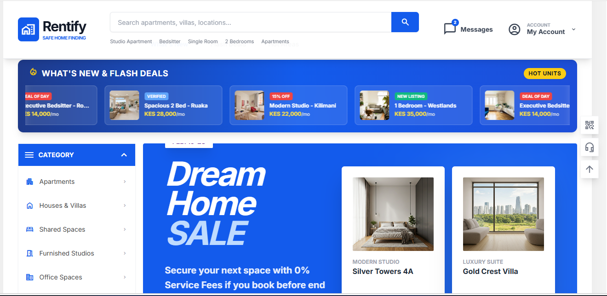
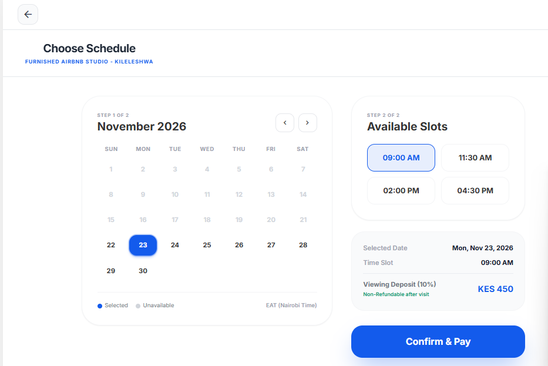
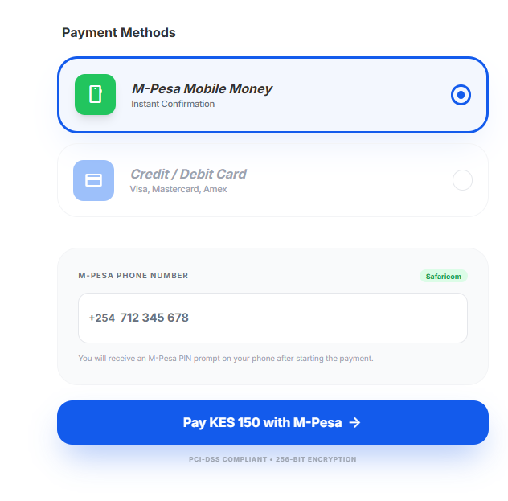
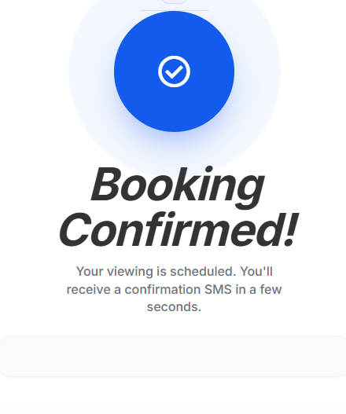
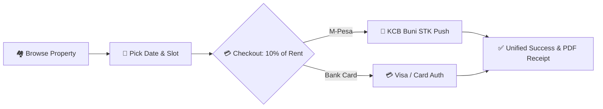

# 🏢 RENTIFY
### Digital Real Estate Marketplace & Automated Viewing Platform

*Eliminating viewing no-shows, unverified listings, and middleman friction across Kenyan real estate.*

<!-- Technology Stack Badges -->

  
  
  
  
  

<!-- Business Status Badges -->

  
  
  

 

<!-- Hero Banner Asset Placeholder -->

---

## 📌 Executive Summary

In fast-growing Kenyan residential and coastal rental markets—from Nairobi to Mombasa and Malindi—house hunting is often slowed down by unverified listings, unscheduled drop-ins, and high viewing no-show rates.

**Rentify** digitizes the entire tenant-to-landlord pipeline into four seamless steps:
1. **Verified Discovery:** Transparent listings with clear monthly rent pricing.
2. **Committed Scheduling:** Real-time date & time booking backed by a **refundable 10% viewing commitment deposit**.
3. **Frictionless Local & Global Checkout:** Instant **M-Pesa STK Push** (via KCB Buni) and **Visa / Bank Card** payments.
4. **Automated Trust & Receipts:** Instant digital receipts, agent notifications, and vetted landlord onboarding.

---

## 📸 Platform Experience & Visual Assets

| 1. Schedule Viewing | 2. Dynamic 10% Checkout | 3. Instant Digital Receipt |
| :---: | :---: | :---: |
|  |  |  |
| *Interactive calendar & time-slot picker* | *Auto-calculated 10% fee via M-Pesa or Visa* | *Print-ready PDF receipt & booking confirmation* |

---

## 💎 Core Value Proposition

<table>
  <tr>
    <td width="50%" valign="top">
      <h3>🏡 For Tenants</h3>
      <ul>
        <li><strong>Zero Guesswork:</strong> Live viewing slots and transparent monthly rent rates upfront.</li>
        <li><strong>100% Refundable Deposits:</strong> The 1% viewing commitment fee is refunded after attending the viewing.</li>
        <li><strong>Flexible Payments:</strong> Pay seamlessly via Safaricom M-Pesa STK Push or Visa/Mastercard.</li>
        <li><strong>Audit-Ready Invoices:</strong> Instant digital receipts with one-click PDF export.</li>
      </ul>
    </td>
    <td width="50%" valign="top">
      <h3>🔑 For Landlords & Agents</h3>
      <ul>
        <li><strong>Serious Leads Only:</strong> Financial commitment eliminates time-wasting viewing no-shows.</li>
        <li><strong>Automated Calendar:</strong> Tenants self-book available windows, cutting back-and-forth calls.</li>
        <li><strong>Verified Partner Status:</strong> Structured landlord KYC onboarding builds instant tenant trust.</li>
        <li><strong>Portfolio Scalability:</strong> Built to manage single units up to multi-apartment complexes.</li>
      </ul>
    </td>
  </tr>
</table>

---

## 💰 Business & Revenue Model

Rentify combines high-frequency micro-transactions with recurring B2B real estate SaaS revenue:

| Revenue Stream | Mechanism | Example |
| :--- | :--- | :--- |
| **Viewing Commitment Escrow** | Dynamic **10% refundable deposit** calculated from monthly rent | `KES 45,000` rent $\rightarrow$ `KES 4,500` deposit |
| **Lease Facilitation Fee** | Success commission collected upon lease execution | Agreed % on first-month rent settlement |
| **Featured Listings & Ads** | Priority marketplace placement for agencies & developers | Monthly tiered visibility packages |
| **KYC & Property Verification** | Fast-track landlord & title verification badges | One-time onboarding verification fee |

---

## 🔄 End-to-End Customer & Payment Flow

---

## 🛡️ Security, Compliance & Architecture

- **Bank-Integrated Mobile Money:** Direct **KCB Buni** integration for real-time M-Pesa STK Push prompts and asynchronous payment callbacks.
- **Enterprise Card Standards:** 256-bit SSL encryption and PCI-DSS compliant card validation.
- **Mobile-First Performance:** Lightweight Tailwind CSS & vanilla JavaScript frontend engineered for fast loading on mobile networks across Kenya.

---

## 🗺️ Strategic Roadmap

- [x] **Phase 1 — Core Marketplace & Checkout:** Property discovery, interactive scheduler, dynamic 10% fee calculator, KCB M-Pesa STK Push, Visa checkout, and unified receipt engine.
- [ ] **Phase 2 — Automated B2C Refunds:** Instant M-Pesa deposit refund triggered upon GPS/agent check-in at the viewing.
- [ ] **Phase 3 — Digital Leasing & Rent Collection:** Automated monthly rent invoicing, reminders, and landlord payout dashboards.
- [ ] **Phase 4 — Regional Expansion:** Scaling landlord partnerships across Nairobi, Mombasa, Malindi, Kisumu, and Nakuru.

---

**Rentify Technologies**  
*Building Trust in East African Real Estate*  
&copy; 2026 Rentify Technologies. All rights reserved.

